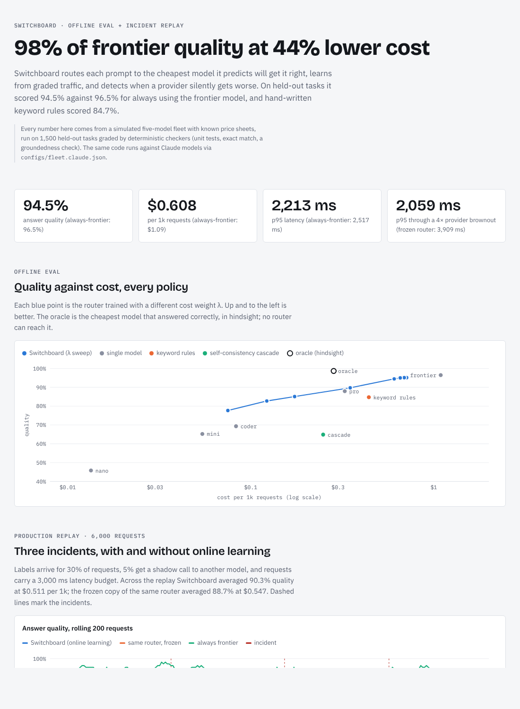

# Switchboard

**A self-tuning LLM router with a built-in eval harness, drift detection and a CI quality gate.**

Switchboard sends each prompt to the cheapest model it predicts will answer it well, learns from
graded traffic, and notices when a provider quietly gets worse or slower. Covers the three parts of
running LLMs in production: **routing**, **evals**, and **LLMOps**.

| | Switchboard | Always frontier | Keyword rules |
|---|---|---|---|
| Answer quality (held-out, 1,500 tasks) | **94.5%** | 96.5% | 84.7% |
| Cost per 1k requests | **$0.61** | $1.09 | $0.44 |
| p95 latency | **2.2 s** | 2.5 s | 1.8 s |
| p95 across the incident replay (incl. 4× brownout) | **2.1 s** | 6.7 s | n/a |

That is **98% of frontier quality at 44% lower cost**, and it holds across seeds: with three seeds the
router kept 97–98% of frontier quality at 48–52% lower cost and beat hand-written rules by 7–10 points
every time.

> **What is simulated.** The numbers above come from a five-model *simulated* fleet (`configs/fleet.sim.json`)
> with price sheets in the range of real small → frontier tiers and a known skill per task type. The
> simulation writes real text that is graded by the same checkers you would use on real output, so
> the whole pipeline is exercised end to end. Point `--fleet` at `configs/fleet.claude.json` and the same
> code routes between Claude Haiku, Sonnet and Opus through the Anthropic SDK.



Open `reports/index.html` for the interactive report (Pareto frontier, incident replay, routing mix).

---

## What it does

```
prompt ─► featurize ─► BanditRouter ─► model ─► graders ─► feedback ─┐
             │        (LinUCB + cost,             │                     │
             │         latency, SLO)              ▼                     │
             │                              trace store (SQLite)       │
             │                                    │                     │
             └────────────── Monitor (Page-Hinkley on residuals) ◄──────┘
                                   │ alarm
                                   └─► router.forget(model)
```

**1. Routing.** `switchboard/router.py`. A contextual bandit (LinUCB) learns, per model, the expected
reward of answering a prompt from 81 prompt features (structural cues plus hashed n-grams). Reward is
1 for a correct answer, 0 for a wrong one and **−1 for an answer with a fabricated claim**, since users
act on confident fabrications. The router picks the model maximising

```
expected_reward + exploration_bonus − λ · $/1k requests − μ · latency_s
```

subject to an optional per-request cost cap and latency SLO. Cost is not learned: it comes from the
price sheet times a predicted output length, so a price change takes effect immediately. Output length
is one shared regression plus a per-model ratio, and latency is the spec-sheet model times a per-model
slowdown factor. Neither estimate drifts when a model starts receiving harder traffic. (An earlier
version used plain running averages, which made the frontier model look more expensive because it got
the long reasoning tasks, so traffic was pushed off it exactly where it was needed.)

**2. Evals.** `switchboard/evals.py`, `switchboard/judge.py`. Seven task types (date formatting,
ticket classification, extraction, arithmetic, multi-step word problems, code, grounded QA), each with
a deterministic checker, so evals cost nothing and run in CI:

- exact or numeric match on the final answer,
- **code is executed** against unit tests in an isolated subprocess with a timeout,
- a **groundedness checker** flags any sentence whose numbers or content words are not supported by
  the context. It needs no reference answer, so it also runs on live traffic.

Every model answers every test task once (the *outcome matrix*), so all policies are compared on
identical outputs. Baselines: each single model, random, keyword rules, a FrugalGPT-style
self-consistency cascade, and an oracle (cheapest model that was right, in hindsight).

**3. LLMOps.** `switchboard/ops.py`, `switchboard/server.py`, `switchboard/tracing.py`.

- **Online learning from sparse labels.** In the replay only 30% of requests are graded, as with
  human review or a sampled LLM judge.
- **Drift detection.** Per-model Page-Hinkley detectors watch *residuals* (observed reward minus the
  router's own prediction), so a model that receives harder traffic does not look like it degraded.
  Latency is watched for spikes and recoveries.
- **Alarm → action.** A quality alarm makes the router forget most of what it knew about that model, so
  it re-learns from post-incident evidence in a few dozen labels instead of thousands.
- **Shadow probes.** 5% of requests also go to a random other model (not shown to the user) to keep
  every model's health stats fresh, so a recovered provider gets traffic back. Cost: $0.013 per 1k requests.
- **Gateway.** A stdlib HTTP server with `/v1/complete`, `/v1/route`, `/v1/feedback`, Prometheus
  `/metrics`, SQLite request traces and a live dashboard.
- **CI gate.** `python -m switchboard gate` re-runs the eval and fails the build if quality drops more
  than 1 point, cost rises more than 10%, the hallucination rate exceeds 8%, or quality falls under 95%
  of the frontier model. See `.github/workflows/switchboard.yml` at the repo root.

## Incident replay

`python -m switchboard simulate` streams 6,000 requests through three incidents and serves them with
three policies side by side: Switchboard, a frozen copy of the same router (trained identically,
never updated), and always-frontier.

| Request | Event | What Switchboard did |
|---|---|---|
| #1,800 | `coder` silently regresses on code and math | `quality_drop` alarm at #2,222; forgot `coder`, moved code to `frontier`/`pro` |
| #3,300 | `frontier` latency ×4 (brownout) | `latency_spike` alarm at #3,308; frontier breaks the 3 s SLO, so traffic moves to `pro` |
| #4,680 | `frontier` recovers | shadow probes see normal latency; traffic returns |

| Across the replay | Quality | $ / 1k | p95 |
|---|---|---|---|
| Switchboard (online) | **90.3%** | **$0.51** | **2.1 s** |
| Same router, frozen | 88.7% | $0.55 | 3.9 s |
| Always frontier | 95.7% | $1.10 | 6.7 s |

Detector reliability over 3 seeds × 6,000 requests: 3/3 regressions and 3/3 brownouts detected, one
false quality alarm (18,000 requests).

## Results in full (seed 0, 1,500 held-out tasks)

| Policy | Quality | Hallucination (RAG) | $ / 1k req | p50 ms | p95 ms |
|---|---|---|---|---|---|
| **switchboard** (λ=0.1) | **94.5%** | 6.0% | $0.608 | 532 | 2,213 |
| keyword-rules | 84.7% | 4.8% | $0.442 | 384 | 1,770 |
| cascade (self-consistency) | 64.9% | 42.5% | $0.249 | 439 | 3,664 |
| random | 71.2% | 44.3% | $0.291 | 416 | 1,607 |
| always-nano | 45.8% | 65.3% | $0.013 | 161 | 446 |
| always-mini | 65.2% | 47.3% | $0.054 | 269 | 722 |
| always-coder | 69.3% | 59.9% | $0.083 | 352 | 916 |
| always-pro | 87.9% | 16.8% | $0.326 | 598 | 1,490 |
| always-frontier | 96.5% | 4.8% | $1.091 | 1,158 | 2,517 |
| oracle (hindsight) | 98.7% | 0.6% | $0.284 | 218 | 1,698 |

λ sets the cost/quality trade. Sweeping it traces the curve in the report: λ=0.2 gives 89.7% at
$0.35/1k, λ=0.5 gives 85.1% at $0.17/1k (above keyword rules at less than half their cost).

## What I learned

- **The cascade loses badly.** Self-consistency ("ask the cheap model twice, escalate if the answers
  differ") fails on code: a weak model makes the *same* bug twice, agrees with itself, and the cascade
  accepts it (11.5% on code). Agreement is not correctness.
- **Running averages leak the traffic mix into the cost model.** See Routing above. The fix was to
  predict per request and keep per-model factors that are independent of the mix.
- **Drift detectors need residuals, not raw quality.** Monitoring raw per-model quality produced false
  alarms whenever the router itself shifted harder work onto a model.
- **The gate caught a real regression.** The first gate run failed on hallucination rate (12%): the
  router treated a fabricated answer as no worse than a wrong one and sent grounded QA to a cheaper,
  less faithful model. Pricing fabrications at −1 fixed it without lowering quality.
- **The oracle shows the headroom.** 98.7% at $0.28/1k means most of the remaining gap is per-instance
  difficulty that prompt features can't see. Next step: a small learned difficulty encoder.

## Run it

Python 3.10+ and NumPy. No other dependencies (`anthropic` only for the real fleet).

```bash
cd projects/switchboard
pip install -e .                      # or just: pip install numpy

python -m switchboard bench           # offline eval of every policy  -> evals/bench.json
python -m switchboard simulate        # 6,000-request incident replay -> evals/drift.json
python -m switchboard report          # both, then reports/index.html
python -m switchboard gate            # CI regression gate (exit 1 on regression)
python -m switchboard route "Write a Python function that merges overlapping intervals"
python -m switchboard serve --demo    # gateway + live dashboard on http://127.0.0.1:8080
python -m unittest discover -s tests  # 14 tests
```

```
$ python -m switchboard route "Write a Python function \`flatten(xs)\` that flattens nested lists"
-> coder

model       reward  bonus     $/1k  est_ms   score
coder        1.000  0.000   0.0528     365   0.987
pro          0.908  0.000   0.2120     691   0.873
frontier     0.905  0.000   0.8000    1226   0.800
mini         0.618  0.000   0.0368     348   0.607
nano         0.291  0.000   0.0088     212   0.286
```

**Real models.** `pip install anthropic`, set `ANTHROPIC_API_KEY`, then use
`--fleet configs/fleet.claude.json` (Haiku 5.5 / Sonnet 5.5 / Opus 5.5 with list prices). Running
`bench` against it calls every model on every task, so start with `--n-train 100 --n-test 100`.

## Layout

```
switchboard/
  dataset.py     seven task generators with references, distractors, unit tests, contexts
  judge.py       graders: exact/numeric match, sandboxed code tests, groundedness checker
  backends.py    simulated models + Claude backend (Anthropic SDK)
  features.py    prompt -> 81-dim feature vector
  router.py      BanditRouter (LinUCB, cost/latency aware, forgetting) + baselines
  evals.py       outcome matrix, policy runs, cascade, oracle, Pareto sweep
  ops.py         Page-Hinkley monitor, production replay with incidents and shadow probes
  tracing.py     SQLite trace store
  server.py      HTTP gateway, /metrics, feedback loop
  report.py      renders the HTML report from evals/*.json
configs/         fleet definitions (simulated, Claude)
evals/           gate thresholds, committed baseline, latest results
reports/         generated report
tests/           unit + behaviour tests
```
